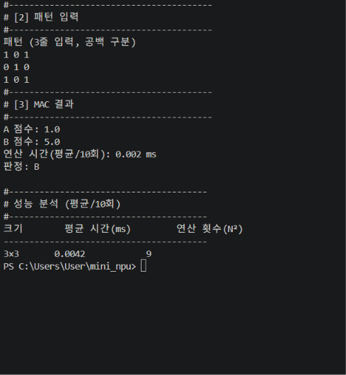
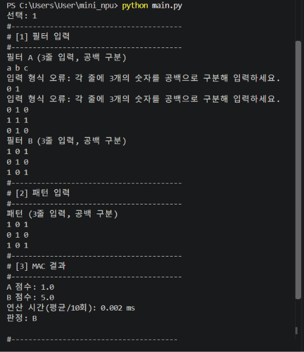
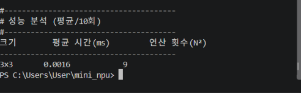
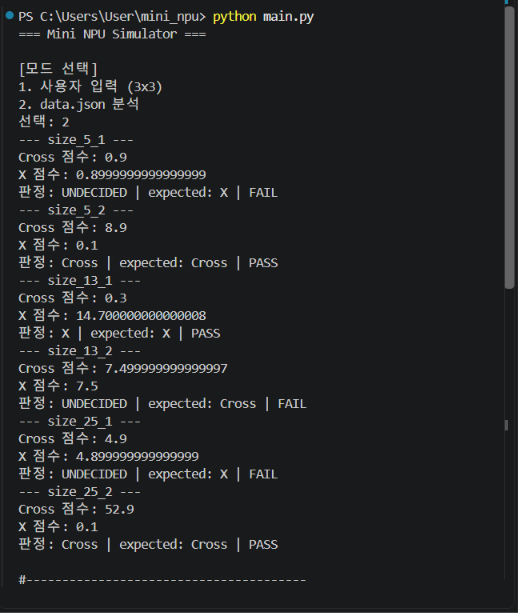
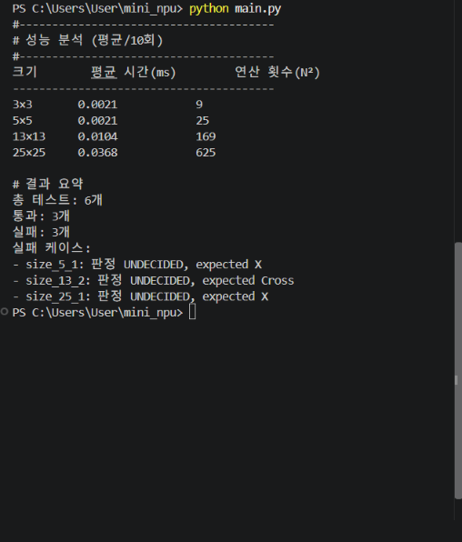

# Mini NPU Simulator

AI 칩(NPU)이 사용하는 MAC(Multiply-Accumulate) 연산을 Python으로 직접 구현해 보는 콘솔 프로그램입니다.

## 실행 방법

1. Python 3.8 이상이 설치되어 있어야 합니다. (외부 라이브러리는 사용하지 않습니다.)
2. `main.py`와 `data.json`을 같은 폴더에 둡니다.
3. 터미널에서 아래 명령어로 실행합니다.

```
python main.py
```

4. 실행하면 모드 선택 화면이 나옵니다.
   - `1` 입력: 사용자 입력 모드 (3×3 필터 2개와 패턴을 직접 입력)
   - `2` 입력: data.json 분석 모드 (5×5, 13×13, 25×25 패턴을 일괄 판정)

## 구현 요약

### 라벨 정규화
- 프로그램 내부에서는 표준 라벨 `Cross`, `X` 두 가지만 사용합니다.
- `data.json`의 필터 키(`cross`, `x`)와 패턴의 `expected` 값(`+`, `x`)은 표기가 서로 다르기 때문에, `normalize_label` 함수로 표준 라벨로 통일합니다.
- 변환 규칙: `+` 또는 `cross` → `Cross`, `x` → `X` (앞뒤 공백 제거, 대소문자 무시)
- 알 수 없는 라벨은 `None`으로 처리하여 프로그램이 멈추지 않게 했습니다.
- 콘솔 출력과 PASS/FAIL 비교는 모두 표준 라벨 기준으로 수행합니다.

### MAC 연산 구현
- `mac(pattern, filt)` 함수가 이중 반복문(`for`)으로 같은 위치의 값을 곱하고 모두 더해 점수(float)를 반환합니다.
- NumPy 같은 외부 라이브러리는 사용하지 않고 표준 라이브러리(`json`, `time`)만 사용했습니다.
- 패턴 이름(예: `size_13_1`)에서 크기(13)를 추출해 해당 크기의 필터(`size_13`)를 선택합니다.
- 필터가 없는 등 문제가 있는 케이스는 해당 케이스만 FAIL로 기록하고 프로그램은 계속 실행됩니다.

### 동점 처리 정책 (epsilon)
- 부동소수점 계산은 미세한 오차가 생기므로 `==` 대신 허용오차 방식으로 비교합니다.
- `abs(score_a - score_b) < 1e-9` 이면 동점으로 보고 `UNDECIDED`(판정 불가)로 처리합니다.
- 동점(UNDECIDED)은 expected와 다르므로 FAIL로 집계합니다.

### 입력 검증
- 모드 1에서 줄마다 숫자 개수가 맞지 않거나 숫자가 아닌 값이 들어오면 "입력 형식 오류" 안내를 출력하고 다시 입력받습니다.

## 결과 리포트

### 실행 결과 요약
- data.json 분석 결과: 총 테스트 6개, 통과 3개, 실패 3개
- 실패 케이스: `size_5_1`, `size_13_2`, `size_25_1` (모두 판정이 `UNDECIDED`)

### FAIL 케이스 원인 분석
- 세 케이스 모두 Cross 점수와 X 점수의 차이가 1e-9보다 작아서 동점(UNDECIDED)으로 처리되었고, expected와 달라 FAIL로 집계되었습니다.
- `size_5_1`: Cross 0.9, X 0.8999999999999999. 필터 값 설계(cross 필터 중앙값 0.9, x 필터 값 0.1)로 두 점수가 사실상 같아졌습니다. 0.8999999999999999는 부동소수점 계산 오차의 흔적입니다.
- `size_13_2`: Cross 7.499999999999997, X 7.5. x 필터 중앙값이 7.5로 설계되어 점수가 거의 같아졌습니다.
- `size_25_1`: Cross 4.9, X 4.899999999999999. cross 필터 중앙값이 4.9로 설계되어 점수가 거의 같아졌습니다.
- 분류: 라벨/스키마 문제는 아닙니다(정규화 후 라벨 비교는 정상). 로직 문제도 아닙니다(MAC 연산은 정상). 데이터 값 설계와 수치 비교 정책(epsilon)이 만든 결과입니다.
- 부동소수점 오차 때문에 `>`로 바로 비교하면 0.9와 0.8999999999999999처럼 사실상 같은 값에서 엉뚱한 쪽이 이기는 문제가 생깁니다. 그래서 허용오차(1e-9) 기반 비교가 필요합니다.
- 이 FAIL들은 버그가 아니라 정책에 따른 정상 결과입니다. 동점을 억지로 한쪽으로 판정하면 오히려 근거 없는 판정이 됩니다.

### 성능 분석 (이번 실행 기준, 평균/10회)

| 크기 | 평균 시간(ms) | 연산 횟수(N²) |
|---|---|---|
| 3×3 | 0.0018 | 9 |
| 5×5 | 0.0038 | 25 |
| 13×13 | 0.0147 | 169 |
| 25×25 | 0.0505 | 625 |

### 시간 복잡도 분석
- MAC 연산은 N×N 칸을 이중 반복문으로 한 번씩 방문하므로 곱셈과 덧셈이 N²번 일어납니다. 따라서 시간 복잡도는 O(N²)입니다.
- 13×13에서 25×25로 갈 때 연산 횟수는 약 3.7배(625÷169), 측정 시간은 약 3.4배(0.0505÷0.0147)로 거의 비슷하게 늘었습니다. 이것이 O(N²)의 근거입니다.
- 3×3은 연산 횟수가 9번뿐이라 함수 호출 같은 고정 비용의 비중이 커서, 25×25와의 시간 비율(약 28배)이 연산 횟수 비율(약 69배)보다 작게 나왔습니다.
- 측정값은 실행할 때마다 조금씩 달라지지만, 크기가 커질수록 시간이 늘어나는 경향은 같습니다.
- CPU는 이 연산을 하나씩 순서대로 처리하지만, NPU는 많은 MAC 연산을 동시에(병렬로) 처리할 수 있어 큰 필터에서 유리합니다.

## 실행 화면

### 모드 1: 정상 실행


### 모드 1: 오류 입력 처리



### 모드 2: data.json 분석

